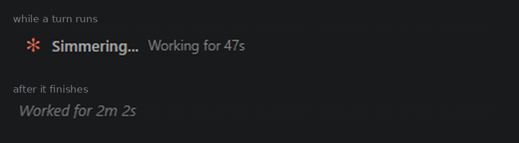

# claude-code-task-timer

Turn timers for the **Claude Code for VS Code** panel. The extension's
`showTurnDuration` setting only renders in the terminal UI, so the panel shows
nothing. This adds it.

Not affiliated with or endorsed by Anthropic. It patches a proprietary extension in
place on your own machine.



## What it adds

- `Working for 1m 2s` next to the spinner while a turn runs.
- `Worked for 5m 52s · 12k out · 1.4M total` under every finished turn in the history:
  output tokens, and everything processed (input, cache reads and writes, output), for the
  main agent and its subagents. Turns past an hour read `1h 2m 3s`.
- A hover tooltip on each message showing when it was sent.
- Workflow-tool agents (ultracode, dynamic workflows) in the panel's **Agent map**, the
  agents pill in the input footer. Each run shows as an agent with its agents under it,
  with state, time, tokens and model; open one for its prompt, result and live transcript.
  Natively the map lists only Agent-tool subagents, and a workflow run is one background
  task with nothing per agent.
- Background tasks in the agents pill: `1 task`, or `2 agents · 1 task`, with the dot lit
  while one runs. Natively the pill counts agents only and hides without any, so a shell
  running in the background looks like nothing is happening. The map already lists these
  tasks, so the click needs nothing.

A message typed mid-turn does not split the timer, and reloading the window mid-turn
does not reset it — the running turn's start is recovered from the transcript.

A background task reporting back (a `run_in_background` shell, a Monitor event) continues
the turn that started it rather than opening a new one: the clock picks up from that
turn's time, and the final label covers every stretch, tokens included. The wait itself
is not counted, so a dev server that exits hours later adds only the reply it gets.
Background subagents are different: the clock keeps running while they work.

## Usage

```sh
node patch-claude-timer.js            # apply
node patch-claude-timer.js --revert   # restore
```

Then run **Developer: Reload Window**.

Finds the extension in the remote/WSL server directory, a local install, and — from
WSL — Windows-side installs. Cursor, Windsurf, VSCodium and Insiders builds are not
covered; add their paths to `extensionRoots()` if you need them.

## Caveats

**Extension updates drop the patches.** New versions install into a new folder. When
the timer disappears, rerun the script.

**Tested against extension 2.1.278** (`linux-x64` and `win32-x64`). Patches are located
by regexes matching the shape of the minified code, so they survive some churn, but not
every release.

**It fails safely.** Each anchor must match exactly once or that patch prints `SKIPPED`
and is left out. The patched bundle is parsed before anything is written; if it does not
parse, nothing is written and the script exits non-zero. Every run rebuilds from a
pristine `index.js.orig`, so patches never stack.

When an anchor breaks, grep the new `webview/index.js` for the code described in the
comment above that anchor and update the regex.

## How it works

Two files. `patch-claude-timer.js` finds the installs and rewrites the bundle;
`panel-helper.js` is the code injected into the panel, kept separate so it reads as
JavaScript rather than one long string.

`PATCHES` holds one entry per edit: a regex `anchor` that must match once (or a set
`count` of times), a `replace` that rewrites it, and optional `prepend`ed code. The
patches wrap the panel's own render function and read its existing state. They never
write to the message array, which carries index bookkeeping, so everything added is
display-only.

Workflow agents come from the CLI's `task_progress` frames, whose `workflow_progress`
lists a run's agents; the panel ignores it, the helper keeps it (and in localStorage, so a
reload keeps finished runs). The map's display reads go through the helper, which adds
those agents to a copy; the panel's own agent state is never written. Their transcripts
load through the panel's existing transcript request, which already finds workflow
agents' files. Runs the panel never saw, such as those from before it was opened, are not
shown.

## License

MIT, see `LICENSE`. Covers this script only. It contains no Anthropic code — it ships
regexes that locate code in an extension you already have installed. The Claude Code
extension is proprietary (© Anthropic PBC) and is not included or redistributed here.
